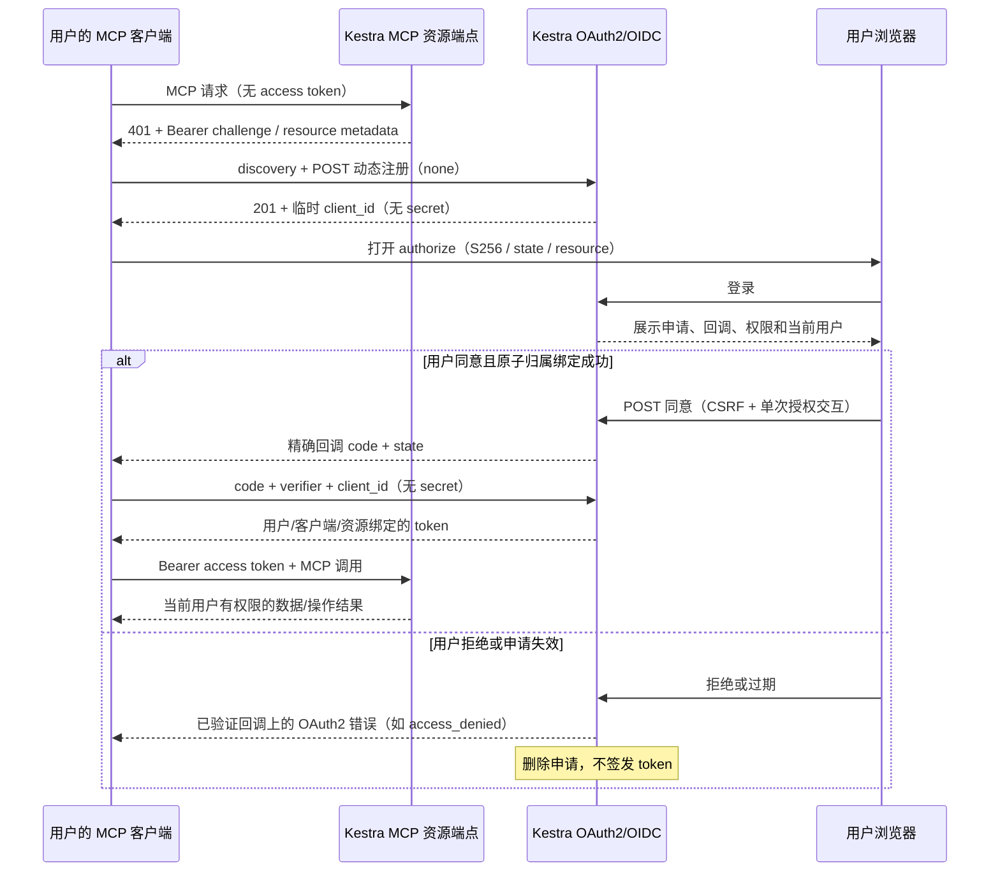

# MCP 客户端与 Kestra：用户归属的 OAuth2 接入方案

## 交付状态与结论

本文是维护者多次澄清后的目标契约，尚未实现，不能作为当前镜像已支持多用户 MCP
隔离的声明。当前已交付 OIDC 首装、登录、public DCR、PKCE 和 token 端点；当前
`oidc_client` 没有 owner，动态注册记录没有临时有效期，authorize 没有用户确认页。
MCP OAuth2 发现、MCP-only Bearer 认证、用户资源隔离和下述生命周期仍待实施。

选定方案可行：保持客户端常见的“先动态注册、再打开浏览器授权”顺序，注册返回
标准 201 JSON 与随机 client_id；服务端先将记录作为短期待绑定申请，用户登录并
明确同意后，原子转为该用户的正式 client。不能在注册 HTTP 请求中返回登录 HTML，
也不要求客户端事先持有用户密码、client_secret 或自定义注册凭证。

这里的临时 client_id 在协议上已是可识别的注册客户端，但在本项目生命周期中
尚未成为用户拥有的正式 client。它只能启动授权，不能取得 token 或调用 MCP。
这一表述避免把“没有永久 client”误解为“注册返回的 client_id 不能用于 authorize”。

## 用户看到的流程

1. 用户在 MCP 客户端填入部署方提供的 MCP 地址。
2. 客户端连接收到 OAuth2 认证挑战，取得资源元数据和授权服务器元数据。
3. 没有可用 client_id 时，客户端向 registration_endpoint 提交回调等元数据，取得
   临时 client_id。public client 无 secret；已有自己的有效 client 可直接进入授权。
4. 客户端生成本次 PKCE verifier/S256 challenge、state，打开浏览器授权页面。
5. 用户在 Kestra 登录；已有有效 IdP 会话可跳过登录，但不能跳过首次归属确认。
6. 页面显示客户端自报名称、完整回调/域名、目标 MCP 资源、申请权限和当前用户。
   名称是未经验证的声明，不能将其渲染为受信任品牌或隐藏实际回调。
7. 用户同意：将 client 绑定当前用户，保存权限授权，签发一次性授权码。
   用户拒绝：不创建正式 client、不签发授权码或 token，删除临时申请。
8. 浏览器回调客户端。客户端用 code、client_id、原 verifier 和精确回调换 token，
   不提交 client_secret。申请 OIDC 时还需 nonce，ID token 不用于调用 MCP。
9. 客户端以 Bearer access token 初始化 MCP、获取工具列表、调用工具；服务端
   按 token 的用户身份和权限访问资源，不以公共或服务端默认身份执行。
10. token 到期按 refresh 策略更新；授权撤销/用户失效/client 删除后拒绝刷新与调用。

## client 归属与多用户隔离

动态 client 归属于一个不可变用户 ID，不归属于管理员或共享用户集合。
首次同意只能由已认证浏览器会话确定 owner；不得接受客户端请求中的 owner、sub、
roles 或 tenant 声明。正式 client 只能由 owner 使用、查看、撤销或删除；同一
客户端软件由不同用户使用时，每人注册不同 client_id，不提供共享动态 client。

已有 owner 的 client 在另一用户会话下请求授权，应拒绝，不自动换 owner，也不
泄露原 owner 信息。页面允许用户切换登录账号；消费方若确需另一个用户，应重新
注册。首次安装的 Kestra 自身 UI confidential client 是系统浏览器登录通道，
保留其现有职责；不能将它作为用户 MCP client、复用其 secret 或据此免除归属检查。

client 身份不等于用户身份。MCP access token 必须验证签名、issuer、有效期、
撤销状态、目标 audience/resource，以及 token subject 与 client owner 的绑定。
授权码和 refresh 记录同样绑定用户、client、回调/授权交互和授权范围；refresh 不得
扩权。MCP 服务端最终以该用户 principal 执行。本仓 scope 门独立检查能力契约；
外部 RBAC 启用后，工具内部每个实际资源操作还必须经过具体资源授权。
仅有 sub 或 roles 声明不构成数据隔离，也不能宣称 OSS 的 tenant 桩已提供多租户。
没有外部 RBAC 时可交付能力级限制，不能宣称具体资源/namespace 隔离已经成立。

## MCP 能力 scope 与外部 RBAC 的独立双层门

本仓预制能力契约 `mcp:<资源大类>:read|write|delete`；资源大类不是具体 namespace
或资源 ID。read 表示查询/查看/列举，write 表示新建/修改且不含删除，delete 单独
授权；三者不自动相互包含。执行/取消等有副作用能力必须逐工具明确分类，不能未经
审查隐含归入 write；具体类别与工具映射在 BASE 工具盘点后定稿。

每个工具声明资源大类、动作和所需 scopes；未知或未声明能力默认不暴露、不执行。
服务端配置可暴露能力 ∩ client 申请 ∩ 用户在同意页确认 = token 授予 scopes。
用户只能收窄，code/token/refresh 不得扩权；同意页把写入与删除清楚分开。
tools/list 可以过滤能力，但 tools/call 必须独立强制检查；复合工具检查全部所需
能力，工具参数不得把只读路径切换为写入/删除或注入更大权限。

| 校验层 | 归属 | 拒绝语义 |
|---|---|---|
| 签名/issuer/有效期/撤销、client owner/sub、audience/resource | 本仓 OAuth2/MCP 认证层 | 无效认证拒绝，不能进入工具执行 |
| 资源大类 read/write/delete、服务端暴露策略与用户二次授权 | 本仓 MCP 能力 scope 门，不依赖 RBAC 模型 | 能力不足拒绝，即使 RBAC 放行也不能扩大 scope |
| 用户对具体资源、动作、namespace 的权限 | 外部 R-EE-RBAC Authorizer | RBAC 启用后逐实际资源操作强制检查，scope 放行不能绕过 |

两层解耦的是实现和权限模型，不是执行时任选其一。RBAC 启用后：scope 允许 AND
外部具体资源授权允许，才可执行。REST 与 MCP 使用同一 principal、资源/动作
规范和授权判定组件；HTTP 路由放行不能代替 MCP 工具内部判定。

必须盘点现有 MCP 工具的直接服务调用、批量、复合、异步及流式路径，为其提供
不可绕过的 Authorizer 激活点与主体传递。执行/异步阶段按明确策略校验授权，不
丢失用户身份或以公共身份代替。RBAC 已启用但组件缺席/错误、主体丢失、资源不明
时失败关闭；未启用 RBAC 则明确处于能力级控制模式，不声称完整数据隔离。
外部角色/资源归属/namespace 模型仍在扩展仓，本仓只提供 scope 契约与衔接面。

验收分层：scope 独立于 RBAC 拒绝危险工具；用户授权缩减后不能调用未授予能力；
write 不允许 delete。RBAC 集成验收必须证明同一用户/资源/动作 REST 拒绝则 MCP
也拒绝且无副作用，包含各工具内部子操作、跨 namespace、异步、组件异常和绕过
尝试。现有执行路径未全部覆盖时，不得宣称 R-EE-RBAC 完整交付。

## 临时申请的存储与清理

| 状态 | 允许的行为 | 存储/额度处理 |
|---|---|---|
| pending，未过期、无 owner | 发起浏览器授权；不能换 token/调用 MCP | 短期申请存储，独立全局 pending 额度与入口限速 |
| 用户确认，事务绑定成功 | owner 专属 client + 授权；允许签发 code | 转正式记录，计入 owner 额度 |
| 用户拒绝 | 已验证回调返回 access_denied | 立即删除 pending；当前浏览器交互终结 |
| 用户关闭窗口、超过期限 | 不再允许授权 | 逻辑立即失效，后台清理物理存储 |
| 已绑定 client 被其他用户拒绝 | 拒绝该次交互 | 不删除原 owner 的 client 或授权 |
| owner 删除/撤销正式 client | 拒绝新授权、refresh 和 MCP 调用 | 撤销关联 code/token/授权，再按保留策略清理 |

初始设计取 pending TTL 30 分钟，可配置并设置合理上下界；从创建时间计算，匿名
访问不续期。过期判断在 authorize、token 和额度路径即时执行，不能依赖定时任务
及时运行。注册事务可清理有限批次过期申请，但不能误删正式 client 或锁住全表做
无限清理。pending 与正式额度分开；现有全局 max-clients 仍作最终总量上限。
拒绝/清理与同意通过数据库行锁或条件更新串行化：同一个 pending 只能确认一次；
若另一请求先删除、过期或绑定，则当前请求失败，不能另建 owner 或继续发码。

已删除/过期 client_id 的 authorize 返回合适的 invalid-client 错误，不向未验证
回调重定向。客户端必须能处理失效注册并重新注册；若 SDK 永久缓存 client_id 且
不能恢复，则兼容性不通过，需记录实际客户端限制，不能仅以 curl 测试宣称可用。

## 安全与标准衔接的实际边界

匿名 DCR 请求时还没有用户，无法将 pending 额度按用户隔离；必须设置全局容量、
IP/可信入口限速和并发限制。用户批准后正式额度才绑定 owner。登录限速、CSRF、
Origin、SameSite、单次短期交互、点击劫持防护与 redirect 精确校验同批验收。
注册元数据不触发远端下载；public client 不允许 client_credentials。

随机 client_id 必须不可预测，但并非 secret。PKCE 证明换 token 者持有本次 verifier，
并不证明匿名注册时的申请人就是浏览器用户。如果 pending client_id 在绑定前泄露，
他人可能先用自己的会话确认归属，至少造成抢占/拒绝服务。标准 DCR+授权码+PKCE
本身不能完全消除此风险：不通过 URL/日志泄露 ID、严格显示用户与回调、单次交互及
原子绑定能减轻风险，但不能宣称“注册者身份已证明”。更强申请人证明需要额外机制
（例如受支持的注册凭证/签名），会影响通用 SDK 兼容性，必须单独评估。

标准参考：RFC7591（DCR）、RFC7636（PKCE）、RFC6749（授权码/错误）、RFC9700
（OAuth2 Security BCP）、RFC8707（资源指示）、RFC9728（Protected Resource Metadata）。
目标 MCP 协议版本、资源元数据路径、resource 参数要求和授权范围尚未锁定；不得
假设普通 OIDC discovery 就等于 MCP 资源发现。MCP API 只接收 access token，拒绝
Basic Auth、ID token、IdP cookie 和跨资源 token。当前 OIDC scopes 是身份信息范围，
不是工具/数据权限；MCP 能力 scope 按上述独立契约实现，不能直接复用 roles=[admin]。

## 实施顺序与验收门

先按用户归属改造 DCR schema/生命周期与授权确认，保留生产首装两路径；再按 BASE
证据接通 MCP OAuth2 发现/Bearer 验证，删除 Basic Auth 选项/实现/商业占位；最后接
本仓能力 scope 与执行 principal，并保留外部 Authorizer 强制衔接点。协议基础设施归 R-OIDC-SERVER，数据授权归
R-EE-RBAC/扩展授权实现，不能把业务资源逻辑复制进协议 patch。

实施前闭环：实际消费仓与 MCP 客户端/版本、BASE MCP Basic Auth/占位源码证据、
目标 MCP 协议版本、资源与 scope 定义、授权执行点、pending/client 迁移方案。
已有无 owner 动态 client 不得自动赋给第一个使用者；应停用并重注册，不猜归属；
首装 UI client 明确识别后保留，其他历史 client 分类不能凭 client_id 前缀判断。

验收必须包含真实客户端，而非仅协议脚本：空库表单/环境首装→匿名 MCP 挑战→
DCR pending→用户 A 登录确认→无 secret S256 code/token→A 数据调用；拒绝与关窗
清理、过期缓存重新注册、错 verifier/state/nonce、跨资源 token、A/B 同时抢占、B
使用 A client、B 查看/删除 A client、同意/拒绝/清理并发、A/B 数据读写隔离、撤销
后旧 token/refresh 拒绝、多副本限速额度、重启持久化、Basic Auth 全面拒绝。
只有这些门与 CI 全绿后，才将本文目标状态改为交付状态。
